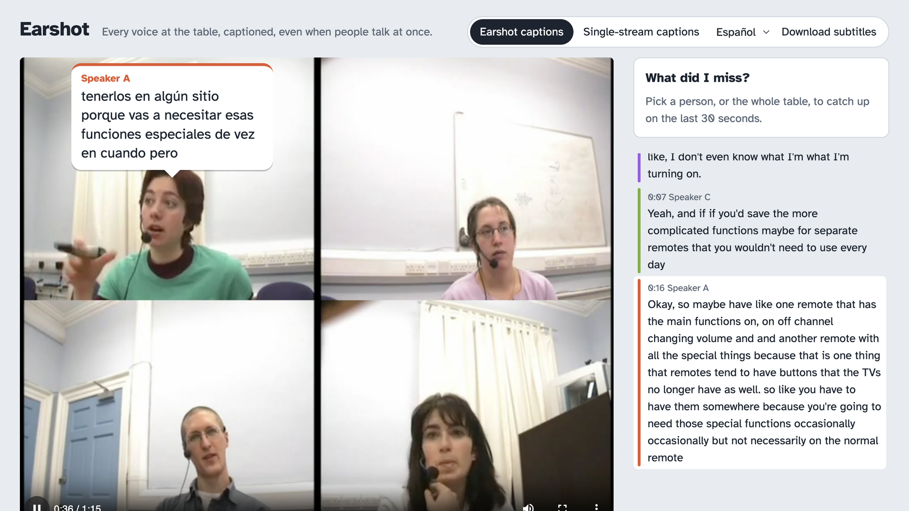

# Earshot

**Every voice at the table, captioned, even when people talk at once.**

Deaf and hard-of-hearing people have a name for being left out of group conversations: *dinner table syndrome*. One of its main causes is people talking over each other. Single-stream captions turn a table into one stream of text: overlapping speech merges or disappears, and you can't tell who said what.

Earshot takes a recorded video of the table and:

1. **tracks each person you tap** with SAM 3.1;
2. can **pull each person's voice out of the mix** with SAM Audio, using that person's masks as the visual prompt. This integration is implemented but **has not run in the included demo** because the gated weights await approval;
3. **captions each voice separately** with Muse Voice Transcribe, or assigns diarized turns to faces with the deterministic Earshot-Lite fallback, and shows face-anchored bubbles;
4. **splits side conversations into threads** and answers **"What did I miss?"** with Muse Spark. Every summary sentence must cite captions and pass deterministic checks, or it's replaced by the captions themselves;
5. offers **cached Spanish bubbles**, positioned/coloured WebVTT, labelled SRT, and per-person audio downloads when isolated stems exist.

> Built during the Meta Global AI Developer Hackathon (26 Oct – 4 Nov 2026). Everything in this repository was written during the event. Meta's cookbook recipe `07_sam/03_headlocked_speech_bubble_captions` already shows speech-bubble captions from diarization plus SAM 3.1, with voices matched to people by hand. Earshot addresses the case that recipe can't handle: separating **overlapping** speech, and binding each voice to a face with **no manual matching**. Earshot reuses no code from that recipe; it follows the cookbook's API request formats. The included real demo uses Lite, and the measured limitations are stated below rather than presented as a separation success.



## Meta models used

| Model | Where it runs | What it does in Earshot | Code |
|---|---|---|---|
| `sam-3.1` | Meta Model API | Tracks each tapped person through the video (point prompts → per-frame masks) | `earshot/tracking.py` |
| SAM Audio (`facebook/sam-audio-small-tv`) | This computer | Optional visual-prompted voice separation; implemented, but **blocked by weight approval and not used in this demo** | `earshot/separation.py` |
| `muse-voice-transcribe-1.0` | Meta Model API | Diarizes the raw mix as the baseline and transcribes isolated voices when available | `earshot/transcribe.py` |
| `muse-spark-1.3` | Meta Model API | Groups threads, writes cited catch-ups, and translates caption text | `earshot/spark.py` |

Everything else is deterministic code: voice activity (frame energy with hysteresis), the caption timeline and bleed filter, Lite assignment, citation checks, metrics, subtitle export, and FFmpeg for media. No other model runs at runtime.

### Rules notes (Meta-only runtime models)

- SAM Audio's released config builds optional **re-rankers**, including **CLAP**, which isn't a Meta model. Earshot turns them off with config overrides (`text_ranker=None, visual_ranker=None, span_predictor=None`) and installs SAM Audio without them (`--no-deps`).
- The organizers resolved the T5 question on 2 Nov at 06:06 in [this Discord thread](https://discord.com/channels/1557169028080869426/1564043204725182484/threads/1566631376868876419):

  > “Yes — SAM Audio is an open-source Meta model, so it counts as a Meta model however you run it, and the frozen T5-base encoder inside it is fine with no workaround or precomputation needed. Organizers have ruled that open-source non-Meta models can run alongside Meta's models as long as Meta's models do real work; disclose the T5 encoder in your README and demo. Closed third-party AI models are still not allowed.”

  This run nevertheless kept the stricter path: **T5 is not loaded**. The two fixed prompts use precomputed outputs in `assets/text_features.npz`; re-rankers stay disabled. The demo does not run SAM Audio at all because Hugging Face returned `Access denied ... requires approval`.
- **Earshot-Lite** (`--separator lite`) needs no SAM Audio. It maps each diarized speaker to a face using motion inside SAM 3.1 masks, exact small-group assignment, and a compression-noise floor. It does **not** separate audio and cannot recover words omitted by the single-stream transcription.

## Run it

Python 3.11 or newer and FFmpeg are required. From a fresh clone:

```bash
python3.11 -m venv .venv && source .venv/bin/activate   # python3.12 also works
pip install -e ".[dev]"
# Install FFmpeg with your OS package manager if it is not already installed.
python -m earshot serve demo/ami_meeting --replay
# open http://127.0.0.1:8765/
```

**Replay needs no API key and normally takes under five minutes from clone to viewer.** The included 42.65 MB demo uses a public AMI Meeting Corpus clip (CC BY 4.0) and real cached model responses. Replay makes no Meta calls. Use the language picker for Spanish, Download subtitles for VTT/SRT, and the catch-up/thread panels.

**Tap to start a new analysis** (recorded clips, not real-time processing):

```bash
export MODEL_API_KEY=...       # only needed for new hosted-model calls
python -m earshot serve --setup table.mp4 --separator lite
```

Click each face and edit the default names, or focus the crosshair and use arrow keys + Enter. Analyze runs in a background thread and shows the actual steps. To rehearse with the cached demo, use `python -m earshot serve demo/ami_meeting --setup table.mp4 --replay`; only taps within 5% of cached people snap, and saved results load immediately. Replay does not mean analysis ran instantly.

The equivalent CLI is:

```bash
python -m earshot analyze table.mp4 \
  --tap "Speaker A@0.31,0.40" --tap "Speaker B@0.68,0.38" \
  --out runs/table --separator lite --translate es
python -m earshot serve runs/table
```

Use `--separator samaudio` only after installing and gaining access to the SAM Audio weights. Export captions offline with:

```bash
python -m earshot export runs/table --vtt table.vtt --srt table.srt
```

### Install SAM Audio (Apple Silicon)

```bash
pip install torch torchaudio torchvision torchcodec "transformers>=4.54" einops torchdiffeq \
    huggingface_hub safetensors timm ftfy regex sentencepiece
pip install "git+https://github.com/facebookresearch/dacvae.git"
# --no-deps: perception_models lists decord and xformers (no macOS arm64 wheels, not needed here)
pip install --no-deps "git+https://github.com/facebookresearch/perception_models@unpin-deps"
# --no-deps: skips laion-clap and imagebind, which only the disabled re-rankers use
pip install --no-deps "git+https://github.com/facebookresearch/sam-audio.git"
hf auth login                  # access to facebook/sam-audio-small-tv is gated on Hugging Face
```

`spike/earshot_spike.py` checks that SAM Audio runs on your machine, times it, and scores the separation on a clip with known ground truth.

## Dinner Table Bench

`python -m earshot bench RUN --truth truth.json` scores a run against what each person actually said:

- **word error rate** per person;
- **right person**: the share of caption words that belong to that person;
- **overlap words**: the share of words spoken while someone else was talking that make it into that person's captions;
- **SI-SDR** of each isolated voice, when clean reference tracks exist.

The baseline is the same table as one diarized stream (what single-stream captions give you). Each anonymous speaker is mapped to the person it matches best, so the baseline is shown at its best. See `earshot/bench.py` for the truth file format. Composed clips (each person recorded separately, then mixed with `spike/earshot_spike.py compose`) give exact references.

## Results

Real AMI ES2008a far-field clip, mean [min, max] over 3 Voice transcription repeats. The single-stream baseline is oracle-mapped and therefore generous; it is not a runtime face-to-voice matcher.

| Mode | WER ↓ | Right person ↑ | Overlap-word recall ↑ | SI-SDR gain (dB) ↑ |
|---|---:|---:|---:|---:|
| Single-stream captions (oracle-mapped) | 0.231 [0.221, 0.237] | 0.919 [0.918, 0.921] | 0.495 [0.444, 0.540] | — |
| Earshot-Lite (optimal mouth-motion attribution) | 0.702 [0.691, 0.714] | 0.540 [0.537, 0.545] | 0.387 [0.369, 0.415] | — |
| Earshot (SAM Audio) | blocked by gated-weight approval | blocked | blocked | blocked |

Lite does not separate audio and underperforms the generous baseline on this clip. SAM Audio has not been run, so no separation claim or metric is inferred. See `bench/RESULTS.md` for the method, exact commands, model IDs, hardware, and negative control.

## How it's built

```
earshot/
  tracking.py     SAM 3.1 object prompts from taps, stream parsing with meta_sam_parser, masks, head anchors
  separation.py   SAM Audio windowed separation (10 s windows, 1 s crossfade); Earshot-Lite passthrough
  transcribe.py   Muse Voice Transcribe file endpoint and repeat-specific cache keys
  activity.py     deterministic voice activity and overlap windows
  timeline.py     per-person captions, bleed filter, overlap flags
  lite.py         exact mouth-motion attribution with a static-noise floor (no separation)
  spark.py        threads + verified catch-up + strictly validated translation
  calls.py        model-call cache, replay mode and provenance log (shown in the viewer)
  bench.py        word-level truth, repeat aggregation, Dinner Table Bench metrics
  export.py       positioned/coloured WebVTT and speaker-labelled SRT
  server.py       tap-to-start jobs, local viewer, Range requests, catch-up and offline export APIs
web/              accessible setup and interactive viewer
demo/ami_meeting  real cached AMI run with JSON responses and attribution
tests/            deterministic unit tests and synthetic runs with explicitly fake clients (never demo evidence)
```

## Limitations

- Earshot analyzes recorded clips; it is not live or real-time. Fresh full-clip SAM mask decoding is slow pure-Python work, although identical runs reuse saved tracks.
- SAM Audio is unverified here because its gated weights are unavailable. Potential separation quality on far-field audio is unknown, not a claimed result.
- Lite does not isolate voices. Its measured right-person and overlap metrics underperform the generous baseline, and the included Lite demo does **not** demonstrate recovery of simultaneous per-person captions or isolated listening.
- Long WebVTT cues can lay out differently across players. Native browser `<track>` rendering and colours were checked; VLC was not installed, so VLC playback is unverified.
- Translation failures retain original text and are labelled visibly. Per-person audio buttons appear only for real isolated stems.

## Use it responsibly

Use Earshot only with people who know they're being recorded. It does no face recognition or identity inference: people are the faces you tap, with the names you type. Do not use private footage or covert monitoring. The included media contains consenting participants from the public AMI corpus.

## Attribution

- **AMI Meeting Corpus:** meeting ES2008a, © University of Edinburgh and AMI Consortium, CC BY 4.0 (https://creativecommons.org/licenses/by/4.0/). Carletta, J. et al. (2005). *The AMI Meeting Corpus: A Pre-Announcement*. MLMI 2005, LNCS 3869. Edited: four close-ups in a 2×2 grid, 12:25–13:40, far-field `Array1-01`; the clean-mic variant uses `Mix-Headset`. The README screenshot and committed demo contain this same public material and Speaker A–D labels, not inferred identities.
- **Meta cookbook:** MIT. Earshot follows the API request formats in `meta-models/meta-model-cookbook`, especially `07_sam`; no recipe code is reused.
- **SAM 3.1, SAM Audio, and `meta_sam_parser`:** SAM License. No SAM weights are redistributed. SAM Audio integration uses `perception_models`; review its licence terms before commercial use.
- **Muse models:** used through the Meta Model API under its terms.
- **Atkinson Hyperlegible:** Braille Institute, SIL Open Font License; loaded from Google Fonts with system fallbacks.

## Licence

MIT, see `LICENSE`. Third-party models, parser code, media, and fonts retain their respective licences above.
