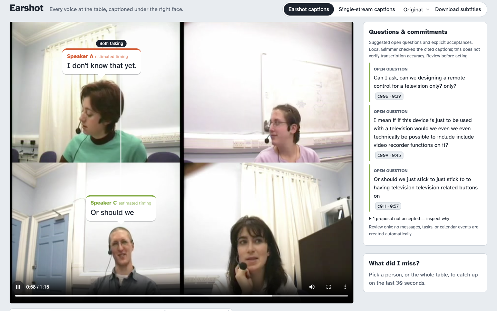

# Earshot

**Every voice at the table, captioned under the right face.**

Deaf and hard-of-hearing people have a name for being left out of group conversations: *dinner table syndrome*. One of its main causes is people talking over each other. Single-stream captions turn a table into one stream of text: overlapping speech merges or disappears, and you can't tell who said what.

Earshot takes a recorded video of the table and:

1. **tracks each person you tap** with SAM 3.1;
2. evaluates voice isolation with SAM Audio and with a classical microphone-array beamformer. SAM Audio failed its quality gate; the **experimental Parallel array demo** also failed its ES2008a overlap-recall gate and is labelled accordingly;
3. **captions each voice separately** with Muse Voice Transcribe, or assigns diarized turns to faces with the deterministic Earshot-Lite fallback, and shows face-anchored bubbles;
4. **splits side conversations into threads** and answers **"What did I miss?"** with local Muse Glimmer or hosted Muse Spark. Summaries cite captions and pass deterministic checks, or fall back to verbatim captions;
5. proposes **questions and commitments** with citations, then checks them with local Glimmer. Unsupported owners, dates, numbers, and citations are rejected. It never sends messages, creates tasks, or books events automatically;
6. offers **cached Spanish bubbles**, positioned/coloured WebVTT, labelled SRT, and per-person audio downloads when isolated stems exist.

> Built during the Meta Global AI Developer Hackathon (26 Oct – 4 Nov 2026). Everything in this repository was written during the event. Meta's cookbook recipe `07_sam/03_headlocked_speech_bubble_captions` already shows speech-bubble captions from diarization plus SAM 3.1, with voices matched to people by hand. Earshot addresses the case that recipe can't handle: separating **overlapping** speech, and binding each voice to a face with **no manual matching**. Earshot reuses no code from that recipe; it follows the cookbook's API request formats. The default demo uses Lite; the separate Parallel demo is an explicitly labelled experiment, not a separation-success claim.


## Meta models used

| Model | Where it runs | What it does in Earshot | Code |
|---|---|---|---|
| `sam-3.1` | Meta Model API | Tracks each tapped person through the video (point prompts → per-frame masks) | `earshot/tracking.py` |
| SAM Audio (`facebook/sam-audio-small-tv`) | This computer | Visual-prompted voice separation, evaluated on the full AMI clip; **no-go on quality, so Lite remains the demo** | `earshot/separation.py` |
| T5-base text encoder (Google, open source, Apache-2.0) | This computer, as part of SAM Audio | Part of SAM Audio's text conditioning. Earshot ships its output for the two fixed prompts as constants (`assets/text_features.npz`), or runs it locally with `--allow-t5`. | `earshot/separation.py` |
| `muse-voice-transcribe-1.0` | Meta Model API | Diarizes the raw mix as the baseline and transcribes isolated voices when available | `earshot/transcribe.py` |
| `muse-spark-1.3` | Meta Model API | Groups threads, optional hosted cited catch-ups, and translates caption text | `earshot/spark.py` |
| `muse-glimmer` | This computer (Ollama) | Cached local cited catch-ups and independent question/commitment evidence checks | `earshot/spark.py`, `earshot/board.py` |

Everything else is deterministic code: classical MVDR beamforming, voice activity (frame energy with hysteresis), the caption timeline and bleed filter, Lite assignment, evidence checks, metrics, subtitle export, and FFmpeg for media. No other model runs at runtime.

### Rules notes (Meta-only runtime models)

- SAM Audio's released config builds optional **re-rankers**, including **CLAP**, which isn't a Meta model. Earshot turns them off with config overrides (`text_ranker=None, visual_ranker=None, span_predictor=None`) and installs SAM Audio without them (`--no-deps`).
- The organizers resolved the T5 question on **2 Nov 2026 at 06:06 Madrid** in [this Discord thread](https://discord.com/channels/1557169028080869426/1564043204725182484/threads/1566631376868876419):

  > “SAM Audio is an open-source Meta model, so it counts as a Meta model however you run it, and the frozen T5-base encoder inside it is fine with no workaround or precomputation needed. Organizers have ruled that open-source non-Meta models can run alongside Meta's models as long as Meta's models do real work; disclose the T5 encoder in your README and demo. Closed third-party AI models are still not allowed.”

  The default remains precomputed outputs in `assets/text_features.npz`; **`--allow-t5` is allowed** and runs T5-base locally. Re-rankers and the span predictor stay off for speed and because CLAP is not Meta. The full SAM Audio run failed its quality go/no-go, so the demo uses Lite.
- **Earshot-Lite** (`--separator lite`) is not a T5 fallback. It is used only if SAM Audio fails the T3 go/no-go. It maps each diarized speaker to a face using motion inside SAM 3.1 masks, exact small-group assignment, and a compression-noise floor. It does **not** separate audio and cannot recover words omitted by the single-stream transcription.

## Run it

Python 3.11 or newer and FFmpeg are required. From a fresh clone:

```bash
python3.11 -m venv .venv && source .venv/bin/activate   # python3.12 also works
pip install -e ".[dev]"
# Install FFmpeg with your OS package manager if it is not already installed.
python -m earshot serve demo/ami_meeting --replay
# open http://127.0.0.1:8765/
```

**Replay needs no API key and normally takes under five minutes from clone to viewer.** The included 42.68 MB demo uses a public AMI Meeting Corpus clip (CC BY 4.0) and real cached model responses. Replay makes no Meta calls. Use the language picker for Spanish, Download subtitles for VTT/SRT, and the catch-up/thread panels.

### Experimental Parallel replay

```bash
python -m earshot serve demo/ami_meeting_array --replay
```

This 47.71 MB package adds actual isolated-audio playback from an **AMI 8-mic meeting-room array**, “Both talking” captions, 35 local catch-ups, Spanish translation, and a local evidence-checked question/commitment board. The real board accepts three literal questions and rejects the conditional “I’ll look into it. If I can.” as an insufficient commitment; expand the rejection to inspect the verbatim evidence. No autonomous actions are taken.



**This is an experiment, not the default demo or verified overlap recovery.** On ES2008a 745 s, right-person is 0.844 but overlap recall is 0.605 against the required 0.622; the older 635 s window also fails. The viewer shows those measurements. Camera-motion/audio lag estimates are not a validated lip-sync correction, so no per-camera offset is applied. Replay corrections go to separate ignored overlay files rather than modifying the packaged evidence. Nothing here claims Earshot runs on Ray-Ban Meta glasses.

To analyze a synchronized eight-channel 16 kHz recording, use `python -m earshot serve --setup table.mp4 --separator array --array array.wav`. This is recorded-clip processing, not live audio, and ordinary stereo audio is not an eight-mic array. A person with an unusable guide gets single-stream attribution without an isolated-audio button; a raw microphone channel is never labelled as their isolated voice.

**Tap to start a new analysis** (recorded clips, not real-time processing):

```bash
export MODEL_API_KEY=...       # only needed for new hosted-model calls
python -m earshot serve --setup table.mp4 --separator lite
```

Click each face and edit the default names, or focus the crosshair and use arrow keys + Enter. Analyze runs in a background thread and shows the actual steps. To rehearse with the cached demo, use `python -m earshot serve demo/ami_meeting --setup table.mp4 --replay`; only taps within 5% of cached people snap, and saved results load immediately. Replay does not mean analysis ran instantly.

The equivalent CLI is:

```bash
python -m earshot analyze table.mp4 \
  --tap "Speaker A@0.31,0.40" --tap "Speaker B@0.68,0.38" \
  --out runs/table --separator lite --translate es
python -m earshot serve runs/table
```

Use `--separator samaudio` only after installing and gaining access to the SAM Audio weights. Export captions offline with:

```bash
python -m earshot export runs/table --vtt table.vtt --srt table.srt
```

### Install SAM Audio (Apple Silicon)

```bash
pip install torch torchaudio torchvision torchcodec "transformers==4.56.2" einops torchdiffeq \
    "huggingface_hub==0.36.2" safetensors timm ftfy regex sentencepiece
pip install "git+https://github.com/facebookresearch/dacvae.git"
# --no-deps: perception_models lists decord and xformers (no macOS arm64 wheels, not needed here)
pip install --no-deps "git+https://github.com/facebookresearch/perception_models@unpin-deps"
# --no-deps: skips laion-clap and imagebind, which only the disabled re-rankers use
pip install --no-deps "git+https://github.com/facebookresearch/sam-audio.git"
hf auth login                  # access to facebook/sam-audio-small-tv is gated on Hugging Face
```

`earshot.compat` handles the missing macOS xformers wheel for SAM Audio's default SDPA attention path; the optional FMHA path still requires xformers and is not used. This keeps the documented `--no-deps` install without silently changing the model's attention implementation.

`spike/earshot_spike.py` checks that SAM Audio runs on your machine, times it, and scores the separation on a clip with known ground truth. Use `--seed` to make conditioning comparisons repeatable.

### Optional local Muse Glimmer

Glimmer can replace Spark for cited catch-ups while keeping conversation text on this computer. It uses Ollama's OpenAI-compatible endpoint (`EARSHOT_LOCAL_BASE_URL`, default `http://localhost:11434/v1`), JSON schema when supported with JSON-mode fallback, and the same deterministic citation/name/number verifier as Spark. Local calls have no Meta API charge and are cached like hosted calls.

```bash
ollama pull muse-glimmer   # about 18 GB installed
python -m earshot analyze table.mp4 \
  --tap "Speaker A@0.31,0.40" --tap "Speaker B@0.68,0.38" \
  --out runs/table-glimmer --separator lite --catchup-model glimmer
```

The included 75 s demo uses local Muse Glimmer for its 35 cached catch-ups. The committed call log contains 15 local inference calls and additional replay hits; the viewer labels them “On this computer.” Hosted Spark still assigns conversation threads and translates captions. Invalid Glimmer summaries fall back to verbatim captions. If showing Glimmer in the submission video, explain that it handles catch-ups locally and why that keeps the transcript on-device.

## Dinner Table Bench

`python -m earshot bench RUN --truth truth.json` scores a run against what each person actually said:

- **word error rate** per person;
- **right person**: the share of caption words that belong to that person;
- **overlap words**: the share of words spoken while someone else was talking that make it into that person's captions;
- **correct-voice rate** from log-energy envelope correlation against reference tracks, for isolated stems and the mixture;
- **SI-SDR** retained in the JSON when references exist, but not used as the headline for far-field mixture/headset comparisons.

The baseline is the same table as one diarized stream (what single-stream captions give you). Each anonymous speaker is mapped to the person it matches best, so the baseline is shown at its best. See `earshot/bench.py` for the truth file format. Composed clips (each person recorded separately, then mixed with `spike/earshot_spike.py compose`) give exact references.

## Results

Real AMI ES2008a far-field clip, mean [min, max] over 3 Voice transcription repeats. The single-stream baseline is oracle-mapped and therefore generous; it is not a runtime face-to-voice matcher. The primary SAM Audio comparison uses its own three repeats; Lite and Spark AV use their previously reported cached repeats.

| Mode | WER ↓ | Right person ↑ | Overlap-word recall ↑ | Correct voice ↑ |
|---|---:|---:|---:|---:|
| Single stream (oracle; primary SAM repeats) | 0.239 [0.231, 0.246] | 0.913 [0.906, 0.918] | 0.480 [0.463, 0.513] | — |
| Earshot-Lite (745 s mouth-band correlation) | 0.231 [0.221, 0.237] | 0.919 [0.918, 0.921] | 0.495 [0.444, 0.540] | — |
| Lite development check (635 s) | 2.571 [0.395, 3.719] | 0.547 [0.473, 0.693] | 0.553 [0.424, 0.624] | — |
| SAM Audio `keep` (745 s) | 0.967 [0.749, 1.227] | 0.386 [0.301, 0.546] | 0.098 [0.037, 0.141] | 0.500 |
| SAM Audio `keep` (635 s held-out) | 2.731 [1.097, 3.825] | 0.382 [0.296, 0.537] | 0.185 [0.158, 0.230] | 0.250 |
| SAM Audio legacy `remove` (745 s) | 0.916 [0.896, 0.935] | 0.464 [0.385, 0.555] | 0.117 [0.097, 0.146] | 0.250 |
| Spark AV experiment (unverified) | 0.852 [0.776, 0.897] | 0.496 [0.455, 0.529] | 0.254 [0.244, 0.262] | — |

The mixture's correct-voice rate is **0.250** on the primary 745 s window. The full `keep` envelope matrix and the 0–10 s mask A/B matrices are in `bench/RESULTS.md`; neither mask mode was diagonal-dominant, so `keep` is the semantic default rather than an A/B winner. SI-SDR remains in the bench JSON with the far-field caveat; `keep` gain is -0.008 dB and legacy `remove` gain is -2.415 dB.

Lite does not separate audio, but its reviewed mouth-band activity correlation matches the generous oracle baseline on its three 745 s repeats. The 60–90% lower-mask band won on 635 s and scored 0.537 on 745 s; the reviewer-fixed 30–60% mouth band scores 0.919 on 745 s and 0.547 on 635 s. With the correction threshold fixed at 0.15, reaching the oracle mapping needed **0 / 0 / 0 taps on 745 s** and **1 / 1 / 0 taps on 635 s**.

### Classical microphone-array results

Mean [min, max] over three real Voice repeats, using the **AMI 8-mic meeting-room array**. The threshold is the better of raw `Array1-01` and GCC-PHAT delay-and-sum overlap recall +0.10. These are runtime Lite-guided results, not oracle-mapped product claims.

| Meeting and window | WER ↓ | Right person ↑ | Overlap recall ↑ | Required recall ↑ | Correct voice ↑ |
|---|---:|---:|---:|---:|---:|
| ES2008a 745 s | 0.282 [0.240, 0.322] | 0.844 [0.835, 0.850] | 0.605 [0.555, 0.662] | 0.622 | 1.000 |
| ES2008a 635 s | 0.403 [0.376, 0.451] | 0.680 [0.623, 0.714] | 0.437 [0.428, 0.442] | 0.586 | 0.750 |

Both existing windows are **NO-GO**. The 745 s run has a 4/4 correct-voice envelope matrix (diagonal 0.6291, off-diagonal 0.0229), but misses the overlap margin by 0.017; 635 s also fails right-person. Four- and five-mic subsets, exact matrices, WER ranges, and timings are in `bench/RESULTS.md`. The separate Parallel player exposes real isolated listening while preserving this negative quality decision.

**SAM Audio `keep` is a quality no-go:** right-person 0.386 is below 0.80 and overlap recall 0.098 does not reach the same-run baseline +0.10 threshold (0.580). Separation took 773.889 seconds including loading, but speed is not a rejection criterion. Lite therefore remains the demo, without an overlap-recovery tagline. Spark AV also failed every adoption gate and remains an unverified negative experiment, not a viewer mode. See `bench/RESULTS.md` for both windows, exact commands, model IDs, hardware, timings, and negative control.

## How it's built

```
earshot/
  tracking.py     SAM 3.1 object prompts from taps, stream parsing with meta_sam_parser, masks, head anchors
  separation.py   SAM Audio windowed separation (10 s windows, 1 s crossfade); Earshot-Lite passthrough
  transcribe.py   Muse Voice Transcribe file endpoint and repeat-specific cache keys
  activity.py     deterministic voice activity and overlap windows
  timeline.py     per-person captions, bleed filter, overlap flags
  lite.py         mouth-band activity correlation and Hungarian voice-to-face assignment (no separation)
  array.py        classical eight-mic MVDR and GCC-PHAT delay-and-sum baseline
  board.py        literal/model candidates plus local evidence verification; no autonomous actions
  quality.py      measured array gate and media-sync caveat from real benchmark artifacts
  spark.py        threads + verified catch-up + strictly validated translation
  calls.py        model-call cache, read-only replay and provenance log (shown in the viewer)
  bench.py        word-level truth, repeat aggregation, Dinner Table Bench metrics
  export.py       positioned/coloured WebVTT and speaker-labelled SRT
  server.py       tap-to-start jobs, local viewer, Range requests, catch-up and offline export APIs
web/              accessible setup and interactive viewer
demo/ami_meeting  default real cached Lite AMI run with JSON responses and attribution
demo/ami_meeting_array  experimental Parallel replay with isolated audio and local evidence checks
tests/            deterministic unit tests and synthetic runs with explicitly fake clients (never demo evidence)
```

## Limitations

- **SAM Audio finding:** It removes noise from speech in our setup (+16.9 dB), but no face or time-span prompt separated one speaker from others, on far-field or clean-mic audio.
- Earshot analyzes recorded clips; it is not live or real-time. Fresh full-clip SAM mask decoding is slow pure-Python work, although identical runs reuse saved tracks.
- SAM Audio `keep` failed the quality go/no-go on the primary far-field clip: right-person 0.386 and overlap recall 0.098, versus the same-run single-stream 0.913 and 0.480. Correct-voice rate was 0.500 versus 0.250 for the mixture; SI-SDR gain was -0.008 dB and is not the headline metric. Separation took 773.889 seconds, but speed alone is not the rejection reason. The 635 s held-out check also failed: right-person 0.382, overlap recall 0.185 and correct-voice rate 0.250. It is not used in the demo.
- Spark AV returned spoken text but failed all adoption gates (WER 0.852, right-person 0.496, overlap recall 0.254). It is an unverified negative experiment, not a viewer mode.
- Lite does not isolate voices or prove recovery of words omitted by single-stream transcription. Its 745 s correlation mapping matches the oracle baseline, but the included demo does **not** demonstrate simultaneous per-person caption recovery or isolated listening.
- Long WebVTT cues can lay out differently across players. Native browser `<track>` rendering and colours were checked; VLC was not installed, so VLC playback is unverified.
- Translation failures retain original text and are labelled visibly. Per-person audio buttons appear only for real isolated stems.
- The experimental array fails its ES2008a overlap-recall gate. Isolated playback is a real feature, not evidence of reliable overlap recovery or lip-sync. Four- and five-mic subsets and the second ES2008a window also fail gates. A degenerate guide falls back to single-stream attribution without isolated audio.
- Glimmer can return empty answers or citations outside the available captions. The verifier rejects those cases and falls back to verbatim captions; local inference is slower than hosted Spark on this machine. Board support means consistency with cited transcripts, not proof that the transcript or a proposed action is correct. Conditional acceptances can be rejected, as the included `c012` example shows.

## Use it responsibly

Use Earshot only with people who know they're being recorded. It does no face recognition or identity inference: people are the faces you tap, with the names you type. Do not use private footage or covert monitoring. The included media contains consenting participants from the public AMI corpus.

## Attribution

- **AMI Meeting Corpus:** meetings ES2008a and ES2008b, © University of Edinburgh and AMI Consortium, CC BY 4.0 (https://creativecommons.org/licenses/by/4.0/). Carletta, J. et al. (2005). *The AMI Meeting Corpus: A Pre-Announcement*. MLMI 2005, LNCS 3869. The ES2008a demo edit has four close-ups in a 2×2 grid, 12:25–13:40, far-field `Array1-01`; the clean-mic variant uses `Mix-Headset`. The independent ES2008b benchmark uses the public 745–820 s window and timed word annotations, with camera assignments checked against corpus metadata. Speaker A–D labels are not inferred identities.
- **Meta cookbook:** MIT. Earshot follows the API request formats in `meta-models/meta-model-cookbook`, especially `07_sam`; no recipe code is reused.
- **SAM 3.1, SAM Audio, and `meta_sam_parser`:** SAM License. No SAM weights are redistributed. SAM Audio integration uses `perception_models`; review its licence terms before commercial use.
- **Muse models:** used through the Meta Model API under its terms.
- **Atkinson Hyperlegible:** Braille Institute, SIL Open Font License; loaded from Google Fonts with system fallbacks.

## Licence

MIT, see `LICENSE`. Third-party models, parser code, media, and fonts retain their respective licences above.
